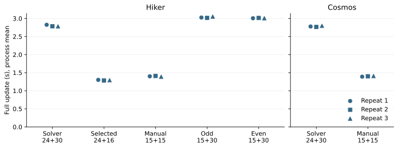
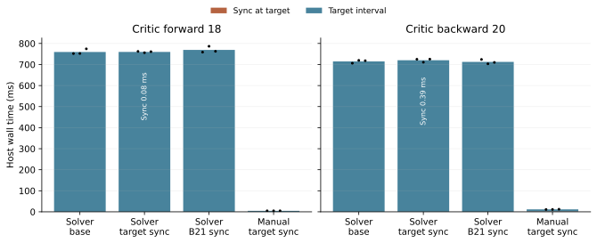

# Activation-memory budgeting for FastVideo Wan training on Ascend 910B2C and NVIDIA H200

The same **53.142 GiB** peak allocation produced **2.80 s** and **1.29 s** mean updates in Wan2.1-1.3B DMD2 training on Ascend 910B2C. A model of activation lifetimes found layouts within budget. Timing a shortlist delivered a **2.16× speedup** against the additive solver, and a targeted synchronization experiment explained the gap. Draining queued device work before a slow critic interval took less than a millisecond. The following allocation still stalled, and independent allocator counters showed repeated cache flushes releasing about **10.6 GiB** at one forward boundary. On NVIDIA H200, device-local calibration met all three tested allocated-memory budgets.

The planner and shortlist are separate FastVideo contributions. The intervention study and measurements are available in this research branch. [Planner PR #2055](https://github.com/hao-ai-lab/FastVideo/pull/2055) · [Selector PR #2120](https://github.com/hao-ai-lab/FastVideo/pull/2120) · [Reproduction and raw measurements](stall_study/)

## What the planner measures

FastVideo chooses a policy for each transformer block before FSDP2 wraps the model. A block can retain activations, recompute them during backward, or offload them to host memory. The profiler measures fixed device storage and the additional storage each choice requires over the training step. At each event, the planner constrains their sum to the byte budget. A mixed-integer solver then minimizes the sum of the selected block costs. Modeling the sequence matters in DMD2, where trainable student and critic graphs overlap with scoring by a frozen teacher. The role profile covers 127 events through clipping and both optimizer updates. [Planner and profiling guide](https://github.com/Gxj230958/FastVideo/tree/125aae85a57a083979ac357e49fad3dd21705054/examples/train/activation_memory)

The experiments use batch size one per device, FP32 master parameters, BF16 computation and 256 × 448 video inputs. A measured update includes forward, backward, optimizer updates and device synchronization. The memory metric is the largest allocated-byte count during a timed update, expressed in GiB (2³⁰ bytes). With this definition, saving 25 of 30 blocks on Ascend allowed 17-frame single-role training to run in 471.82 ms at 23.498 GiB. Full recomputation took 554.91 ms and saving every block used 24.885 GiB. Earlier integration tests also exercised gradients, AdamW state restoration, two-rank execution and sampling from an updated checkpoint. [Native training results](https://github.com/Gxj230958/FastVideo/blob/125aae85a57a083979ac357e49fad3dd21705054/docs/training/activation_memory.md)

## From an additive prediction to a measured shortlist

The fitted additive model predicted 1192.46 ms for a solver layout retaining 24 student and 30 critic blocks. Its measured update took 2757.26 ms. A paired trace against the tuned manual reference localized 97.7% of the device-stream time difference to two intervals. The interval starting at critic forward block 18 averaged 764.49 ms versus 4.56 ms under the manual layout. At critic backward block 20 the corresponding means were 706.54 and 8.90 ms. In both traced backward steps, the host spent about 700 ms in `empty_tensor`. These intervals include adjacent FSDP transitions. [Original paired trace](stall_study/prior/b1_event_gap.json)

Two low-cost corrections were tested on the same six held-out Cosmos layouts. A bilinear student–critic interaction had a maximum absolute relative error of 73.5%. A threshold on the total number of saved blocks reduced the median absolute relative error to 1.51%, but its maximum remained 56.1%. For 15 student and 30 critic saves, the threshold model predicted 1297.22 ms against 2953.00 ms measured. A good typical prediction still left enough error to select an expensive configuration. [Held-out fits](stall_study/prior/b1_time_model.json)

The selector enumerated 56 uniformly spaced student/critic layouts, filtered all 56 against the event-level budget, and benchmarked 18 of the 54 feasible layouts on Cosmos. Each candidate received two warmup updates and five timed updates. The winning 24+16 layout averaged 1350.12 ms on Cosmos. After freezing the choice, three fresh processes evaluated it on hiker with five warmups and five timed updates each. [Candidate matrix](stall_study/prior/b1_shortlist_matrix.json)

| Ascend DMD2 layout, 17 frames | Mean update (ms) | Peak allocated (GiB) |
|---|---:|---:|
| Full recomputation | 1497.69 | 53.142 |
| Tuned manual periodic layout | 1318.19 | 53.142 |
| Additive solver, 24+30 | 2757.26 | 53.142 |
| Measured shortlist, uniform 24+16 | **1300.42** | **53.142** |

The three shortlist evaluation means were 1296.25, 1311.88 and 1293.14 ms, all within the 1450 ms target. The selected layout recovered the performance of the manual reference. [Original validation](stall_study/prior/b1_validation.json) Its 2.12× speedup is relative to the earlier additive solver.

## Why two layouts with the same peak take different times

We replayed the solver's exact nonuniform 24+30 map, the periodic 15+15 reference and the frozen 24+16 winner. Two controls fixed the critic at 30 saves and retained either the odd or the even student blocks. All five passed the original event-level 54 GiB screen. On each of three physical 910B2Cs we ran one fresh process per layout with the same model, seed (2026), input, expandable-segment allocator, five warmup updates and five timed updates. Layout order varied by card. Uninstrumented runs timed complete synchronized updates. Across both videos, the study used 75 single-device processes on six physical 910B2Cs, with 120 uninstrumented, 72 profiler and 30 counter-only measured updates. The unit of replication was a fresh process. [Exact maps and reproduction](stall_study/) · [Process means](stall_study/evidence/processes.csv)

| Hiker layout (student + critic saves) | Card 0 / 1 / 2, process mean (ms) | Mean (ms) | Peak allocated / reserved (GiB) |
|---|---|---:|---:|
| Original solver, 24+30 | 2825 / 2784 / 2780 | 2796.61 | 53.142 / 60.369 |
| Selected uniform, 24+16 | 1301 / 1285 / 1292 | 1292.58 | 53.142 / 60.072 |
| Manual periodic, 15+15 | 1400 / 1409 / 1388 | 1398.66 | 53.142 / 57.381 |
| Odd student blocks, 15+30 | 3026 / 3015 / 3051 | 3030.52 | 53.142 / 60.369 |
| Even student blocks, 15+30 | 3006 / 3013 / 3006 | 3008.36 | 53.142 / 60.369 |

Moving all 15 student saves by one block changed mean step time by 22 ms. Keeping the same odd student blocks and switching the critic from 30 saves to 15 reduced it by 1632 ms. The exact block map also matters for feasibility. Replacing the solver's original 24+30 positions by a uniform 24+30 map would predict 54.077 GiB, above budget. With the other study workers stopped, a serial check on card 0 reproduced the ranking: 2762 ms for the solver, 1400 ms for manual and 1282 ms for the selected layout.

*Each point is a fresh process's mean over five timed updates. All five Hiker layouts reached the same 53.142 GiB allocated peak. The two Cosmos conditions independently compare the original solver and manual layouts.*

### Move the wait to a known point

If a host allocation spent 700 ms waiting solely for work already submitted at block entry, a device-wide synchronization immediately before that interval should absorb most of the delay. We timed this barrier and the following host interval separately. A no-barrier trace, the corresponding manual layout and a barrier at adjacent backward block 21 supplied controls. Reverse traversal visits block 21 immediately before 20. Each cell below uses three fresh processes with two traced updates after five warmups. [Step-level timings and operator self times](stall_study/evidence/events.csv)

| Hiker layout and target | No barrier, host interval (ms) | Target barrier (ms) | Host interval after barrier (ms) |
|---|---:|---:|---:|
| Solver, critic forward 18 | 759.58 | 0.08 | 759.69 |
| Manual, critic forward 18 | 4.57 | 0.09 | 4.57 |
| Solver, critic backward 20 | 714.60 | 0.39 | 719.97 |
| Manual, critic backward 20 | 10.13 | 1.84 | 9.74 |

At solver backward 20, `empty_tensor` accounted for 713.82 ms of host self time after synchronization. All six post-barrier intervals were between 700.01 and 750.06 ms. Synchronizing one block earlier took 0.52 ms and left 712.49 ms at block 20. Forward attribution varied between `empty_tensor` and `aten::stack`. The waits therefore persisted after draining work submitted before entry. We froze backward 20 for the second clip because the Hiker backward operator attribution was consistent. On Cosmos, the solver interval averaged 717.92 ms without a barrier. With a 0.45 ms barrier it averaged 726.11 ms, including 719.20 ms in `empty_tensor`. The uninstrumented solver and manual updates averaged 2779.02 and 1399.17 ms.

*Bars show host wall time at the named target. Points show each process mean. For “B21 sync” the barrier ran at backward 21, outside the plotted target interval. Profiler wall time includes trace processing and is excluded from all speedups.*

### Observe the allocator without the CPU profiler

On three additional cards we sampled cumulative allocator counters immediately before and after each target interval, with no added barrier or CPU profiler. In the slow solver layout, **all 12 forward-18 intervals across Hiker and Cosmos** contained one allocation retry and released **10.59–10.61 GiB** of reserved storage per interval (rounded). Hiker's six manual and six selected forward intervals and Cosmos's six manual intervals had zero retries and zero released reserve. PyTorch's Ascend backend defines this retry counter as a failed device allocation followed by a cache flush and another attempt. All observed windows had zero terminal OOMs. [Allocator measurements](stall_study/evidence/allocator.csv) · [Ascend counter definitions](https://github.com/Ascend/pytorch/blob/v2.9.0/torch_npu/npu/memory.py#L284-L288)

| Counter-only observations | Updates | Forward 18 with retry | Backward 20 with retry | Backward 21 with retry |
|---|---:|---:|---:|---:|
| Hiker, solver | 6 | 6 | 4 | 1 |
| Hiker, manual | 6 | 0 | 0 | 0 |
| Hiker, selected | 6 | 0 | 0 | 0 |
| Cosmos, solver | 6 | 6 | 4 | 1 |
| Cosmos, manual | 6 | 0 | 0 | 0 |

In each clip, one backward retry landed one block early and one update had no retry in either monitored backward window. The device-stream markers, targeted synchronization and allocator counters together identify repeated reserve reclamation in the slow layout. Timing candidates end to end lets the selector avoid the measured cost without having to predict exactly which backward hook will observe it.

## Budget feasibility on H200

H200 profiles were collected for each workload and input shape using PyTorch 2.9.1+cu128. The table gives the predicted peak of each solver plan and the observed maxima across five timed updates. All three measured allocations fell within budget. The narrowest observed margin was 0.334 GiB for 33-frame single-role training. [Profiles, plans and measurements](https://github.com/Gxj230958/FastVideo/tree/125aae85a57a083979ac357e49fad3dd21705054/meas_h200)

| H200 workload | Budget (GiB) | Blocks saved | Predicted allocated (GiB) | Measured allocated (GiB) | Measured reserved (GiB) | Mean update (ms) |
|---|---:|---|---:|---:|---:|---:|
| Single role, 17 frames | 24 | 25 | 23.933 | 23.544 | 29.855 | 555.14 |
| Single role, 33 frames | 28 | 23 | 27.901 | 27.666 | 34.943 | 570.51 |
| DMD2, 17 frames | 54 | 24 student + 30 critic | 53.902 | 53.514 | 66.160 | 1222.07 |

At 33 frames the earlier Ascend single-role plan saved 22 blocks and averaged 579.67 ms at 27.479 GiB. Both devices therefore met the 28 GiB target with a shape-specific plan, using different save counts. The 17-frame single-role plans selected the same count of 25. Counts alone do not identify which blocks the solver retained.

## Transferring a DMD2 layout

The fixed 24+16 layout provides a direct check on whether the Ascend choice can execute under the same H200 budget. It reached 53.544 GiB and averaged 1244.42 ms on H200, compared with 53.142 GiB and 1300.42 ms in the Ascend validation. Comparing layouts within H200 gives a different picture. The solver had a 22.35 ms lower observed mean than the transferred layout and the largest reserved peak. The uniform 15+30 layout had the lowest observed mean of the three. On Ascend, the same 15+30 uniform layout had been slow enough to exclude during tuning.

| H200 DMD2 layout, 17 frames | Warmups | Timed updates | Mean update (ms) | Peak allocated (GiB) | Peak reserved (GiB) |
|---|---:|---:|---:|---:|---:|
| Transferred uniform 24+16 | 2 | 5 | 1244.42 | 53.544 | 62.057 |
| Device-calibrated solver 24+30 | 5 | 5 | 1222.07 | 53.514 | 66.160 |
| Manual uniform 15+30 | 2 | 5 | 1188.19 | 53.536 | 63.426 |

## Interpretation and limits

The memory constraints transferred through device-local calibration. Layout timing was more sensitive to the runtime and to which blocks were live together. For this workload, event-level constraints provided a practical way to reduce the search space, and timing complete updates exposed costs that the block model missed.

- **Memory scope.** All budgets apply after warmup. H200 reserved peaks exceeded the nominal budgets in all five runs. Initialization, warmup and driver memory require additional capacity when sizing a physical device.
- **Timing scope.** Each H200 configuration contributed one process with five sequential updates. Different warmups place the solver and fixed layouts at different training iterations. Ascend used torch-npu 2.9 with expandable segments, whereas H200 used the default CUDA allocator. The 17-frame H200 sample was robot and the Ascend validation sample was hiker. The means describe these runs and cannot isolate a hardware-only speedup or establish a reliably fastest H200 layout.
- **Data and calibration.** The 33-frame H200 sample repeats nine Cosmos source frames. DMD2 parquet rows reuse one source video. These runs exercise training and memory behavior, with no measure of downstream video quality. The DMD2 fixed-memory residual comes from its own 127-event all-recompute observation. Two 62-event references and the incremental calibration metadata in the H200 DMD2 profile were inherited from its single-role template.
- **Mechanism scope.** Event boundaries include adjacent FSDP work. Stream markers bound one stream and cannot establish device-wide idleness. A pre-entry barrier tests work already submitted at that boundary. Work submitted inside the interval, driver mapping costs and release costs can all contribute. The counters identify retry and reclamation but do not measure fragmentation or apportion time among allocator internals. The Cosmos check reuses an earlier tuning clip with a frozen intervention, so the two clips establish repeatability at this shape.
